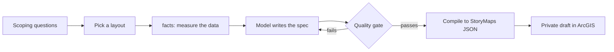

# storymap-gen


**Generate ArcGIS StoryMaps with every claim fact-checked against your GIS data.**

A language model writes fluent map stories, and some of the facts are wrong. In the story this project came from, Northern
Boulevard was labelled the street that "breaks the grid"; measuring the street layer shows it runs parallel to the avenues.
storymap-gen has the model write a typed **spec**, checks each claim and each number in the prose against the data, and
only then compiles a StoryMap.

```text
$ storymap-gen run examples/jackson_heights_broken.json --data streets_centerline=fixtures/streets_centerline.geojson
Claims (3)
  FAIL  northern-diagonal: NORTHERN BLVD: median deviation from grid axis = 0.1 deg (...) -> parallel; claim says diagonal_to_grid
        fix: NORTHERN BLVD measures as parallel: set relation to 'parallel_to_grid', or choose a street that really is diagonal
  ERROR broadway-diagonal: street 'BROADWY' not found in layer 'streets_centerline'
        fix: did you mean: BROADWAY?
  PASS  avg-width: mean(st_width) = 32.62, claimed 32.6 +/- 0.1
Numbers in prose: 1 NOT backed
  UNBACKED 35 in section 'Streets' intro
        fix: attach a claim that states the number (claim_ids), or list it in allow_numbers
Quality gate FAILED; nothing written.
```

## Quickstart
No ArcGIS account is needed to get this far; the data samples are in the repository.
```bash
git clone https://github.com/hazelxue/storymap-gen && cd storymap-gen
pip install -e .
storymap-gen run examples/jackson_heights_open_space.json \
  --data streets_centerline=fixtures/streets_centerline.geojson parks_=fixtures/parks.geojson subway_stations_=fixtures/subway_stations.geojson
```
That verifies four claims (including the 14.33 acres of public park, reproduced from the data), compiles the story, and writes `story.json`.
Try `examples/barcelona_eixample.json` for a second city (OpenStreetMap data, no numbered grid).

## How it works

The quality gate checks that the spec is valid, every claim is true against the data, every number written in prose is backed by a
claim, citations are consistent, and the node graph is valid. Details and vocabulary: [docs/concepts.md](docs/concepts.md).

## Use it
| how | when |
|---|---|
| **CLI** `storymap-gen run / facts / preview / schema / publish` | scripting and CI |
| **Python** `from storymap_gen.api import build, load_store` | notebooks, your own pipeline |
| **MCP server** `storymap-gen-mcp` ([docs/mcp.md](docs/mcp.md)) | let an agent do the verify-first loop |
| **Claude Code skill** [`skill/SKILL.md`](skill/SKILL.md) | guided flow: login, scoping questions, layout preview, measure, write, verify, draft |

Claim types ([docs/claims.md](docs/claims.md)): `street_orientation`, `layer_stat`, `layer_area`, `within_distance`.
Layouts: `docked-sidecar`, `floating-sidecar`, `longform`. Spec schema: [docs/spec.schema.json](docs/spec.schema.json).

## Publish a draft
Creates a **new private draft**; it never touches an existing story and never handles credentials.
```bash
export ARCGIS_TOKEN=...      # a 60 minute token you obtained by approving an OAuth consent
storymap-gen publish story.json --title "My story" --username <your-user>
```
One-time setup: create an OAuth "Developer credentials" item (user authentication) in your organisation, open
`<portal>/sharing/rest/oauth2/authorize?client_id=<id>&response_type=token&expiration=60&redirect_uri=<registered uri>` and click Allow;
the token is in the redirect URL. Review the draft in the StoryMaps Builder and publish it yourself.

## Evidence
- **Tests**: unit, property-based (any valid spec compiles to a valid graph), MCP protocol tests, and a contract test against the live
  service (`pytest -m network`, also run weekly in CI). The graph checker accepts a real 174-node published story.
- **Opened in the real Builder**: all three layouts were published as private drafts and rendered correctly (v0.1).
- **A second domain**: orientation checks on Barcelona's Eixample separate Avinguda Diagonal (25.1 degrees off the grid) from the Cerdà streets (about 1 degree).
- **Experiment with real model calls** ([experiments/RESULTS.md](experiments/RESULTS.md)): simulated users, 12 chains per arm.

  | | direct | ask first | ask first + measured facts |
  |---|---|---|---|
  | accepted on first draft | 0% | 17% | 100% |
  | mean rounds | 2.0 | 2.0 | 1.0 |
  | cost per chain | $0.176 | $0.133 | $0.086 |

  Asking scoping questions removed preference rework but **not** factual rework: about 20% of the model's data claims were wrong either
  way, most often calling Northern Blvd diagonal. Measuring first removed it. Auditing the recorded specs with the prose-number check
  found that 6 of 12 direct and 3 of 12 ask-first specs had numbers in the text that no claim backed.

## Limits
- StoryMaps item JSON is not an officially documented API; the format was reverse-engineered from a published story and is guarded by the contract test.
- Only numbers in prose are bound to claims. Qualitative statements are not verified.
- The experiment uses simulated users, small samples and one model; the LLM judge shares a model family with the writer.
  A second judge run is prepared but was not completed (see RESULTS.md).
- Orientation facts (`storymap-gen facts`) cover street orientation only. The MCP server has not yet been exercised inside Claude Desktop or Claude Code.
- One theme (`slate`). Maps open at the Web Map's default extent unless a slide sets `extent`.

## Contributing and license
See [CONTRIBUTING.md](CONTRIBUTING.md) (including how to add a claim type) and [CHANGELOG.md](CHANGELOG.md). MIT, see [LICENSE](LICENSE).
Data sources and terms for the fixtures: [fixtures/README.md](fixtures/README.md).
