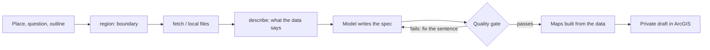

# storymap-gen


**Give it a place and a question. Get an ArcGIS StoryMap with maps, built from real data, where every number is checked.**

You say where (a neighbourhood or district anywhere), what you want to understand, and optionally an outline. The data can be your own
files, public data downloaded for you (OpenStreetMap, any public ArcGIS layer), or both. A language model writes the story as a typed
spec; storymap-gen measures the data, rejects any claim or number the data does not support, builds the maps, and creates a private draft in your ArcGIS account.

Why the checking matters: a language model writes fluent map stories, and about one in five of the data claims it made in our experiment was wrong
(most often calling Northern Boulevard "diagonal to the grid"; measured, it runs parallel to the avenues).

```text
$ storymap-gen run examples/jackson_heights_broken.json --data streets_centerline=fixtures/streets_centerline.geojson
Claims (3)
  FAIL  northern-diagonal: NORTHERN BLVD: median deviation from grid axis = 0.1 deg (...) -> parallel; claim says diagonal_to_grid
        fix: NORTHERN BLVD measures as parallel: set relation to 'parallel_to_grid', or choose a street that really is diagonal
  ERROR broadway-diagonal: street 'BROADWY' not found in layer 'streets_centerline'
        fix: did you mean: BROADWAY?
  PASS  avg-width: mean(st_width) = 32.62, claimed 32.6 +/- 0.1
Numbers in prose: 1 NOT backed
  UNBACKED 35 in section 'Streets' intro
        fix: attach a claim that states the number (claim_ids), or list it in allow_numbers
Quality gate FAILED; nothing written.
```

## Quickstart: try it offline
No account and no download are needed; the data samples are in the repository.
```bash
git clone https://github.com/hazelxue/storymap-gen && cd storymap-gen
pip install -e .
storymap-gen run examples/gracia_barcelona.json --manifest fixtures/gracia/manifest.json
```
That checks seven claims about a Barcelona district (street length, park area, schools within 400 m of a park, ...) against real OpenStreetMap data, builds the maps,
and writes `story.json`. More examples: `examples/jackson_heights_open_space.json` (NYC open data), `examples/barcelona_eixample.json` (a city with no numbered streets).

## Any place, from scratch
```bash
storymap-gen region "Park Slope, Brooklyn" --out region.json                 # place name -> boundary
storymap-gen fetch --region region.json --layers streets parks transit --out data/   # public data, cut to the boundary
storymap-gen describe --manifest data/manifest.json                          # what is really in the data
storymap-gen init --region region.json --topic "Green space in Park Slope" --manifest data/manifest.json --out spec.json
#  ... write the story (a model, or you): replace every TODO, back every number with a claim ...
storymap-gen run spec.json --manifest data/manifest.json                     # verify, build, quality gate
storymap-gen login --client-id <id>                                          # in YOUR terminal; hidden prompt
storymap-gen publish-spec spec.json --manifest data/manifest.json --title "Green space in Park Slope"
```
Use your own data instead (or as well) with `--data name=file.geojson`. The easiest way to drive all of this is the **Claude Code skill**
([`skill/SKILL.md`](skill/SKILL.md)): it asks for the place, topic, outline and data source, fetches and inspects the data, drafts, verifies, and hands you a draft link.

## How it works

The gate checks that the spec is valid, every claim is true against the data, every number in the prose is backed by a claim, no placeholder text is left, citations
are consistent, and the node graph is valid. Details: [docs/concepts.md](docs/concepts.md). Data sources, themes and caveats: [docs/data-sources.md](docs/data-sources.md).

## Use it
| how | when |
|---|---|
| **Claude Code skill** [`skill/SKILL.md`](skill/SKILL.md) | guided flow from a place and a topic to a draft |
| **CLI** `storymap-gen region / fetch / describe / init / run / facts / preview / schema / login / publish-spec` | scripting and CI |
| **MCP server** `storymap-gen-mcp` ([docs/mcp.md](docs/mcp.md)) | let an agent run the loop; fixed public data sources only, no publishing |
| **Python** `from storymap_gen.api import build, load_store, publish_spec` | notebooks, your own pipeline |

Claim types ([docs/claims.md](docs/claims.md)): `layer_stat`, `layer_area`, `layer_length`, `within_distance`, `street_orientation`. Layouts: `docked-sidecar`, `floating-sidecar`,
`longform`. Spec schema: [docs/spec.schema.json](docs/spec.schema.json).

## Signing in and publishing
`publish-spec` creates **private** Web Maps and a **private** story draft; it never touches an existing item. Signing in uses ArcGIS's own OAuth page, and the
token goes into a hidden prompt in your terminal, never a chat window:
```bash
storymap-gen login --client-id <Client ID>      # prints the consent URL; you approve it; paste the address you land on
storymap-gen logout                             # deletes the saved token
```
One-time setup: in your ArcGIS organisation create a "Developer credentials" item with **OAuth 2.0 (user authentication)** and the redirect URL
`https://localhost:8765/storymap-gen-callback`; the item page shows the Client ID (it is not a secret). The token lasts about an hour and is kept in a user-only
file until it expires (`--no-save` keeps nothing). You can also set `ARCGIS_TOKEN` yourself. The token is only ever sent to an `*.arcgis.com` portal over https
(ArcGIS Enterprise hosts must be listed in `STORYMAP_ALLOWED_PORTAL_HOSTS`), and redirects are never followed. Review the draft in the StoryMaps Builder and publish it yourself.

## Security and reliability
Inputs are treated as untrusted, because the spec comes from a model that may have read hostile text. Highlights (full audit: [docs/security.md](docs/security.md)):
claim filters are parsed with a whitelist instead of evaluated; model-supplied regexes cannot cause catastrophic backtracking; every size is bounded; downloads refuse
private addresses, redirects and oversized responses; the token cannot be sent to a non-ArcGIS host; the MCP server reads and writes only inside a data root and has no publish tool;
tests never touch a real token or cache. A 20,000-input random soak test produced no crash, and fuzz tests run in CI. Report vulnerabilities as described in [SECURITY.md](SECURITY.md).

## Evidence
- **Tests**: unit, property-based, fuzz, MCP protocol, security regressions, an offline end-to-end run from a place name to a draft, and a contract test against the live StoryMaps service (`pytest -m network`, also weekly in CI).
- **Real services**: geocoding, Overpass downloads and clipping were run against the live services for an unseen district; the first run exposed a flaw (a nature reserve inflated a district's park area 160x) that mocks could not, now fixed and pinned by tests.
- **Opened in the real Builder**: all three layouts rendered from compiled drafts, now including maps generated from data. See the worked example [docs/showcase/gracia.md](docs/showcase/gracia.md) and what the real service exposed, [docs/validation-log.md](docs/validation-log.md).
- **Experiment with real model calls** ([experiments/RESULTS.md](experiments/RESULTS.md)): measuring the data before writing raised first-draft acceptance from 0% to 100% and halved the cost; asking scoping questions removed preference rework but not factual rework.

## Limits
- StoryMaps item JSON is not an officially documented API; the format was reverse-engineered from a published story and is guarded by the contract test.
- **Generated maps** (features embedded in a Web Map) were opened in the live ArcGIS service and in all three layouts; that run found four defects that tests had missed, all fixed ([validation log](docs/validation-log.md)). Only a few places have been checked live, so expect more.
- OpenStreetMap coverage varies by place, and it has no demographics. Only what is in the data can be claimed; numbers about people need data you supply.
- Only numbers in prose are bound to claims. Qualitative statements are not verified.
- Places are limited to 150 km2 (neighbourhood or district scale); maps hold up to 20,000 features per layer and about 8 MB.
- One theme (`slate`), three layouts. The experiment used simulated users and one model.

## Contributing and license
See [CONTRIBUTING.md](CONTRIBUTING.md) (adding a claim type, a data theme, a layout), [CHANGELOG.md](CHANGELOG.md). MIT, see [LICENSE](LICENSE).
Data sources and terms for the fixtures: [fixtures/README.md](fixtures/README.md).
