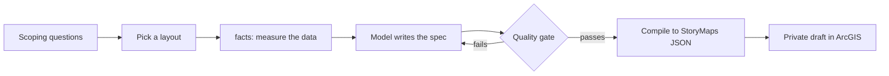

# Concepts

## The problem
A language model writes fluent map stories, and some of the facts in them are wrong. In the project this tool came
from, a story marked Northern Boulevard as the street that "breaks the street grid". Measuring segment bearings
showed it runs parallel to the avenues (0.1 degrees off the grid axis). Broadway is the diagonal one (37.1 degrees).
In a real-model experiment about 20% of the data claims a model wrote about the street layer were wrong, and
Northern Boulevard was the most common mistake.

storymap-gen makes that check automatic, and runs it **before** anything is compiled or published.

## Vocabulary

| term | meaning |
|---|---|
| **spec** | The only thing the model writes: a JSON document (title, sections, slides, sources, claims). Validated by `StorySpec`. Schema: [`spec.schema.json`](spec.schema.json). |
| **claim** | A sentence about the data that can be checked by a program, such as "Broadway is diagonal to the grid" or "named parks cover 14.33 acres". See [claims.md](claims.md). |
| **facts** | Measurements taken from the data *before* writing (`storymap-gen facts`), so the writer starts from true numbers. |
| **grounding** | Two checks: every claim is true against the data, and every number written in prose is backed by a claim. |
| **quality gate** | The final yes/no: valid spec, all claims pass, no unbacked numbers, citations consistent, node graph valid. Nothing is written if it fails. |
| **layout** | `docked-sidecar` (text panel beside a map), `floating-sidecar` (full map, floating text card), or `longform` (article with inline maps). |
| **draft** | A private StoryMap item created from the compiled JSON. You review it in the Builder and publish it yourself. |

## Pipeline

The gate sits in a loop with the writer: a failing claim comes back with a measured value and a suggested fix,
so the model corrects the spec instead of the story.

## Design decisions
- **The model writes a spec, never raw StoryMaps JSON.** A typed spec fails early and cheaply (unknown source, claim
  id that does not exist); a compiler owns the fiddly node graph and the HTML escaping.
- **Claims are executable.** A claim is data plus a `check()` method, not a comment. Adding a kind is one class.
- **Measure first, then write.** In the experiment, giving the writer measured facts raised first-draft acceptance
  from 0% to 100% and halved the cost. Asking scoping questions alone removed preference rework but not factual rework.
- **Prose numbers are bound to claims.** Proving a claim is true does not prove the sentence says the same thing, so
  numbers in the text must match a claim attached to that block (years, ordinals, street names and labels are ignored;
  rounding to the written precision is allowed).
- **Publishing never touches existing stories and never handles credentials.** Drafts only; the token comes from the
  environment; the MCP server does not expose publishing at all.

## What is not verified
- Prose that makes a claim without a number ("the park is crowded") is not checked. Only numbers are bound.
- The `text` field of a claim is documentation; the check runs on its parameters.
- Claim ids attached to a block are trusted. Attaching an unrelated true claim to a block does not make its prose true.
- The StoryMaps item format is not an officially documented API. A live contract test (`pytest -m network`) guards against drift.
