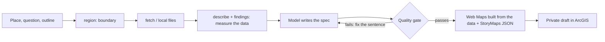

# storymap-gen: design document

Status: v0.5.1, released, MIT licence. Repository: https://github.com/hazelxue/storymap-gen
Audience: a reader who wants to understand what was built, why it is built this way, and how well it was tested. No ArcGIS knowledge is assumed.

## 1. Summary
storymap-gen turns a place name, a topic and public (or the user's own) map data into a **draft ArcGIS StoryMap** (a web article with maps, key numbers and pictures), and refuses to build it unless **every number in the text is checked against the data**.

The problem it addresses: a language model writes fluent map stories, and some of the facts are wrong. In an experiment with real model calls, about 20% of the data claims the model wrote about a street layer were wrong (for example calling a street "diagonal to the grid" when it measures 0.1 degrees off it). A reader cannot see that, so the check has to be automatic and has to run before anything is published.

The core idea is a **verify-first pipeline**: the model writes a typed *spec* (not the final format); a program measures the data, checks every claim, ties every number in the prose to a claim, and only then compiles the StoryMaps JSON and creates a private draft.

## 2. Goals and non-goals
Goals
- A non-programmer can go from "this place, this question" to a reviewable draft in one sitting.
- No number in the story is unsupported by the data. Failures come back with a measured value and a suggested fix.
- Works for any neighbourhood or district, not only the places it was developed on.
- Safe by default: model output and downloaded data are treated as untrusted; the tool creates private drafts only and never deletes anything.
- Usable three ways: Claude Code skill, command line, MCP server (plus a Python API).

Non-goals (stated in the README as limits)
- It does not write vividly or find interviews, photos of people, local history. The writer (a model or a person) does that.
- It does not check that a true number sits next to the right noun, or verify captions and qualitative statements (see section 8).
- No demographic data of its own; no cities larger than 150 km2; no charts, timelines or galleries.

## 3. Users and flow
Primary user: a student or analyst with a place and a question, signed in to an ArcGIS organisation account.

The gate sits in a loop with the writer: a failing claim returns a measured value and a fix, so the model corrects the spec rather than the story.

## 4. Architecture
About 5,900 lines of Python in `storymap_gen/`, 478 automated tests.

| layer | modules | role |
|---|---|---|
| Data in | `sources/nominatim`, `sources/overpass`, ArcGIS/GeoJSON fetch via `net.py`, `sources/context` | place name to boundary polygon (several places combine into one study area); OpenStreetMap layers clipped to the boundary; Wikipedia/Wikimedia Commons background and pictures from an allow-list, licence-filtered |
| Understanding the data | `describe`, `findings`, `explore`, `subareas`, `aggregate`, `join` | what is in the layers; a battery of measurements ranked by how notable they are (reach at several distances, gaps, concentration, skews), returned as claims that already pass; an interactive map; per-district measures; user tables joined to polygons |
| The contract | `spec.py` (pydantic, unknown fields refused), `claims.py` | the typed spec the model writes; eight executable claim kinds |
| The gate | `claims`, prose-number binding, `depth.py`, `webmap.map_problems` | claims true, numbers backed, no placeholders, citations consistent, maps refer to real layers and filters, thin-story report |
| Building | `compiler.py`, `webmap.py`, `thematic.py`, `images.py` | spec to StoryMaps node graph; Web Maps with the data embedded, filters, graduated-colour renderers, swipe maps; pictures uploaded to the draft |
| Publishing | `auth.py`, `loopback.py`, `publish.py` | OAuth sign-in in the browser (PKCE), private Web Maps and a private draft |
| Interfaces | `__main__.py` (CLI), `mcp_server.py`, `skill/SKILL.md`, `api.py` | four ways in, one pipeline underneath |

## 5. Key design decisions
Each entry: the decision, the alternative, why.

1. **The model writes a spec, never StoryMaps JSON.** Alternative: let the model emit the final format. A typed spec fails early and cheaply (unknown source, claim id that does not exist, unknown field), and a compiler owns the fiddly node graph and HTML escaping, so a model mistake cannot corrupt the draft.
2. **Claims are executable.** A claim is data plus a `check()` method, not a comment; adding a kind is one class. Eight kinds: `layer_stat`, `layer_area`, `layer_length`, `within_distance`, `street_orientation`, `layer_share`, `layer_density`, `area_coverage`. Filters in claims use a whitelist parser, not `eval`.
3. **Measure first, then write.** Giving the writer measured facts before it writes is the largest effect found (section 7). `findings` automates this for any place.
4. **Numbers in prose are bound to claims.** Proving a claim true does not prove the sentence says the same thing, so a number in a paragraph must match a claim attached to that block. Years, ordinals, street names and licence versions are exempt. This catches the most common failure (a number with nothing behind it); it does not catch a correct number attached to the wrong words.
5. **Maps are generated from the same data the claims use.** A first design drew whatever the layer contained; the live service showed a map with 21 transit features beside text claiming 6 stations. Maps now carry filters and styles, and the gate refuses a map that names a missing layer or a filter that selects nothing.
6. **Private drafts only, never delete.** The tool cannot touch an existing item. The user reviews in the StoryMaps Builder and publishes.
7. **No keys in the product.** The skill runs inside the user's own Claude Code; the tool calls no model and holds no API key. Sign-in uses the ArcGIS authorization-code flow with PKCE and a one-shot listener bound to 127.0.0.1.
8. **Depth is reported, not enforced.** A report says where a story is thin (short, map with no caption, section with no measured fact). Making it blocking would push a writer to pad text.

## 6. Security and privacy model
Inputs are untrusted because the spec comes from a model that may have read hostile text, and data comes from the network.
- Claim filters parsed with a whitelist; model-supplied regular expressions cannot cause catastrophic backtracking; every size is bounded.
- Downloads go through one client that refuses private addresses (including multicast and IPv4-mapped IPv6), redirects and oversized responses; hosts for context and pictures are allow-listed; pictures are identified by their bytes.
- The access token is only ever sent to an `*.arcgis.com` portal over https; redirects are never followed; the token file is user-only; `logout` revokes the renewal token.
- The loopback listener accepts one path, local addresses only, a random `state`, logs nothing, closes after one request, three-minute limit.
- The MCP server reads and writes only inside a data root and has no publish tool.
- Repository hygiene: `scripts/privacy_check.py` scans the working tree and the full history for identifiers, secrets and personal paths; it runs as a pre-push hook and in CI.

Tests include a 20,000-input random soak run with no crash, fuzz tests in CI and regression tests for each reported weakness (full audit in `docs/security.md`).

## 7. Evaluation
Four kinds of evidence, in order of how much they should be trusted.

**a. Real-service validation.** The tool was run against the live geocoder, Overpass and ArcGIS for places it was not built around (Gràcia, Barcelona; six central districts of Tianjin, China). Thirteen defects were found that offline tests could not (`docs/validation-log.md`). Examples: unclipped data made a park area 160 times too large; points with 64-bit OpenStreetMap ids silently did not draw because the map used 32-bit integer fields; pictures given as web addresses are ignored by the Builder. Each is fixed and pinned by a test.

**b. Controlled experiment with real model calls** (`experiments/RESULTS.md`; simulated users, one model, two personas, 10 to 12 chains per arm, cost $5.55).

| | direct | ask scoping questions first | ask first + measured facts |
|---|---|---|---|
| accepted on the first draft | 0% | 17% | 100% |
| mean rounds to acceptance | 2.0 | 2.0 | 1.0 |
| data-claim accuracy in round 1 | 80% | 79% | 100% |
| cost per chain (USD) | 0.176 | 0.133 | 0.086 |

Reading: asking removes preference rework but not factual rework; measuring before writing is what removes factual errors and halves cost. Caveat recorded in the results: the facts arm covered a fixed list of seven streets and behaves like an answer key for them; whether accuracy holds on streets outside the list was not tested, and the judge and writer are the same model family.

**c. A fresh model with only the skill.** On the Tianjin data a separate model produced a 1,500-word story (4 sections, 7 maps, 45 claims) in about seven minutes; the gate passed after three fix rounds and caught a number with no claim. It also exposed a gap the gate cannot close (a correct number paired with the wrong half of a comparison). Its own rating was "roughly a B"; this is a self-assessment, not a reader study.

**d. Automated tests.** 478 tests: unit, property-based, fuzz, MCP protocol, security regressions, an offline end-to-end run from a place name to a draft, and a contract test against the live StoryMaps service, also run weekly in CI.

Not done: no study with real users. The first release is going to a small group with a short feedback form (a GitHub issue template).

## 8. Known limits (also in the README)
- The StoryMaps item JSON is not an officially documented API. It was reverse-engineered from published stories and watched by the contract test; Esri can change it.
- The gate cannot check that a true number belongs to its sentence, or captions and qualitative statements.
- Only OpenStreetMap and user-supplied data: coverage varies by place, no demographics, so "reach" is reach of land, not of people.
- 150 km2 per place; 20,000 features and about 8 MB per map; one theme, three layouts; tested in one organisation's portal.
- Visual quality was judged by opening drafts in the real Builder; there is no automated visual check.

## 9. Possible next steps
- A claim-to-sentence check (needs language understanding, so likely a second model as reviewer with a recorded false-positive rate).
- Population data and per-district comparisons by default.
- A `--theme` option for `findings` so measurements are ranked for the question asked.
- Hosted feature layers for larger places.
- A study with real users to replace the simulated ones.

## 10. How it was built
Built with Claude Code as an AI pair-programmer. The author defined the problem and scope, directed the design (verify before publishing, a typed spec instead of raw StoryMaps JSON, private drafts only), chose what to test against the live services, reviewed every failure those runs exposed, and decided what to release and what to disclose as a limit. The AI assisted with implementation, tests and debugging.

The controls on that process are the ones above: executable claims, the quality gate, a validation log that records each real-service failure, and a privacy and security check before every push.
