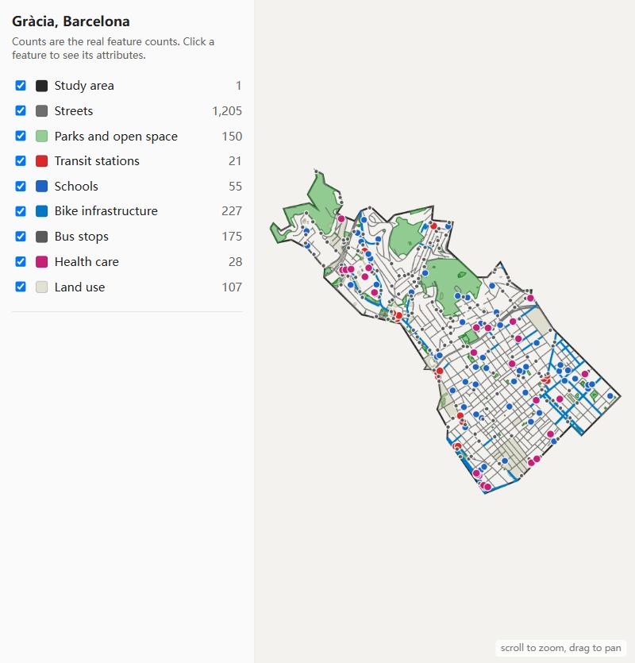
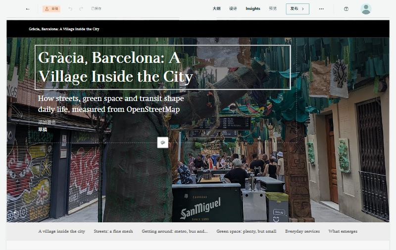
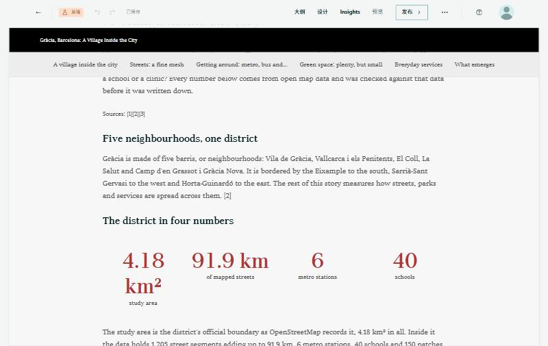
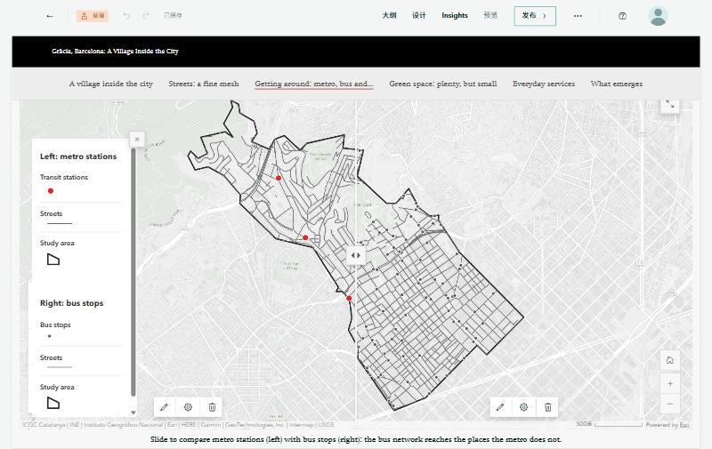
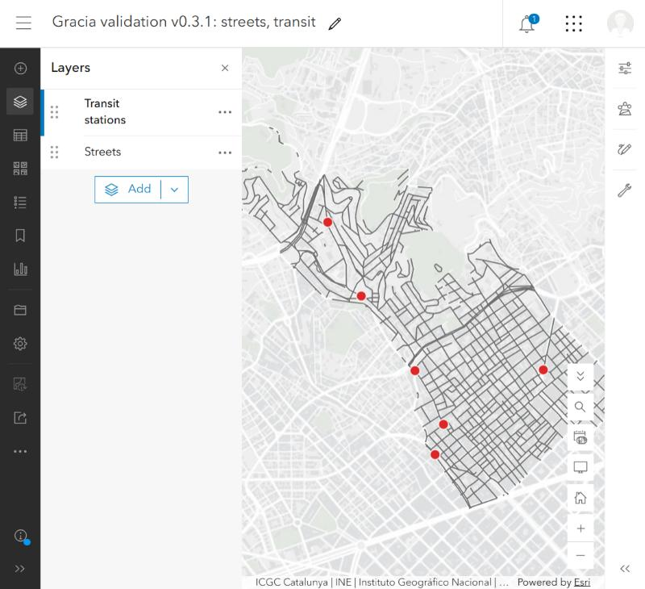

# Showcase: Gràcia, Barcelona, from a place name to a verified story draft

A district the tool was not built around, run end to end against the real services, then opened in the real StoryMaps Builder. Everything below is reproducible from this repository:
`fixtures/gracia/` holds the downloaded data, so the verification step runs offline.

```bash
storymap-gen run examples/gracia_barcelona_full.json --manifest fixtures/gracia/manifest.json
storymap-gen explore --manifest fixtures/gracia/manifest.json --open
```

## What went in
- A place: "Gràcia, Barcelona" (geocoded to a boundary polygon with Nominatim).
- A thesis and an outline: *a district of short distances, with three gaps*; streets, getting around, green space, services, what emerges ([examples/gracia_barcelona_full.json](../../examples/gracia_barcelona_full.json)).
- Data: OpenStreetMap streets, bike infrastructure, parks, metro stations, bus stops, schools and health facilities, downloaded with `storymap-gen fetch` and clipped to the boundary.

## What the tool checked before it would build anything
46 claims, all measured on the data. The kinds of sentence they back:

| sentence | claim type |
|---|---|
| "91.9 km of streets", "6 metro stations" | `layer_length`, `layer_stat` |
| "29% of street length is living streets" | `layer_share` |
| "42 bus stops per km2" | `layer_density` |
| "63% of the district is within 500 m of a station" | `area_coverage` |
| "82% of green area is in three parks" | `layer_share` (by area) |
| "every education site is within 400 m of a green space" | `within_distance` |
| "the Ronda de Dalt runs 29.6 degrees off the street grid" | `street_orientation` |

The gate also caught a wrong sentence while the story was being written: the draft said 64% of schools are within 400 m of a station; measured, it is 62%. It refused to build until the sentence was fixed.

## What the data looks like before anything is written
`storymap-gen explore` opens every downloaded layer on one map, with the real feature counts, so you see the data before choosing a thesis:



## What came out
A private draft with six sections, 17 subsections, nine maps (two of them swipes), two rows of key figures, lists, three pictures with credits and a numbered source list, opened in the Builder:

| | |
|---|---|
|  |  |
| The cover (photograph: KRLS, [CC BY 4.0](https://creativecommons.org/licenses/by/4.0/), via Wikimedia Commons). | A row of key figures; each value is checked against a claim. |



*A swipe map. The street base shows on both sides; the slider reveals metro stations (left) and bus stops (right), which makes the point of the paragraph above it: the bus network reaches the places the metro does not.*



*Each map shows exactly what the text counts: here only the six stations, not the 15 station entrances in the same layer.*

## What real use taught
Opening the result in the real services found defects that no offline test could: points that silently did not draw, pictures the Builder ignores unless they are uploaded to the story, a data theme that counted "no bike lane" as bike lane.
All are in the [validation log](../validation-log.md), with how each was fixed.
