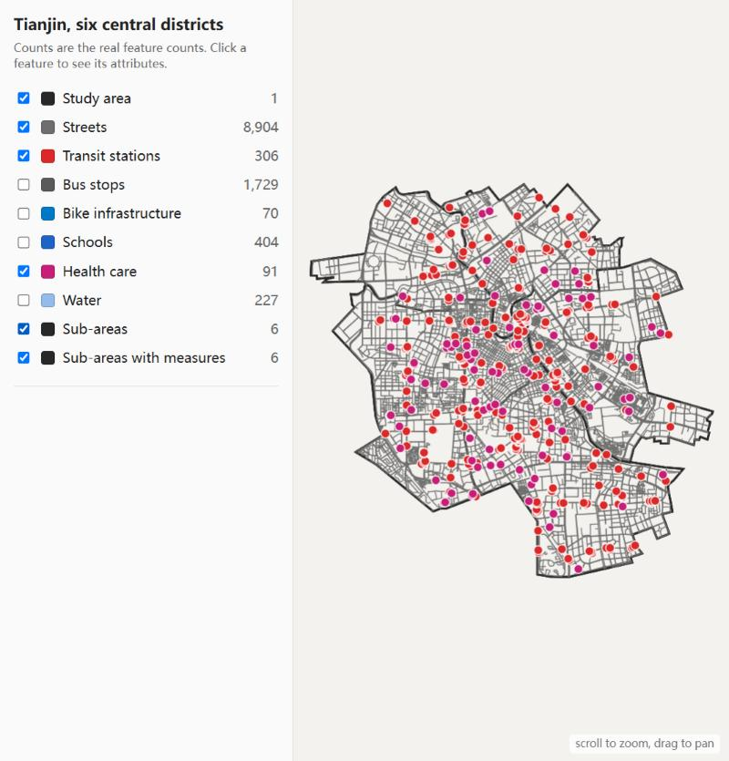
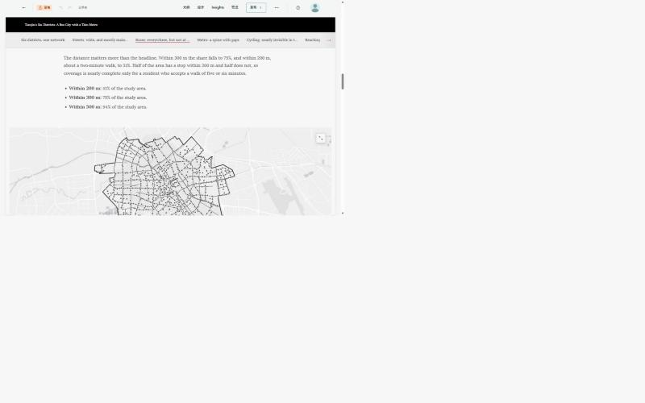
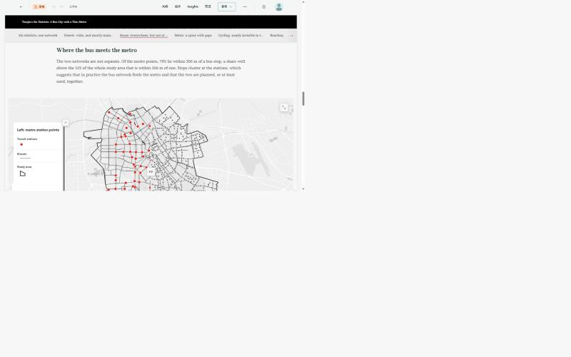
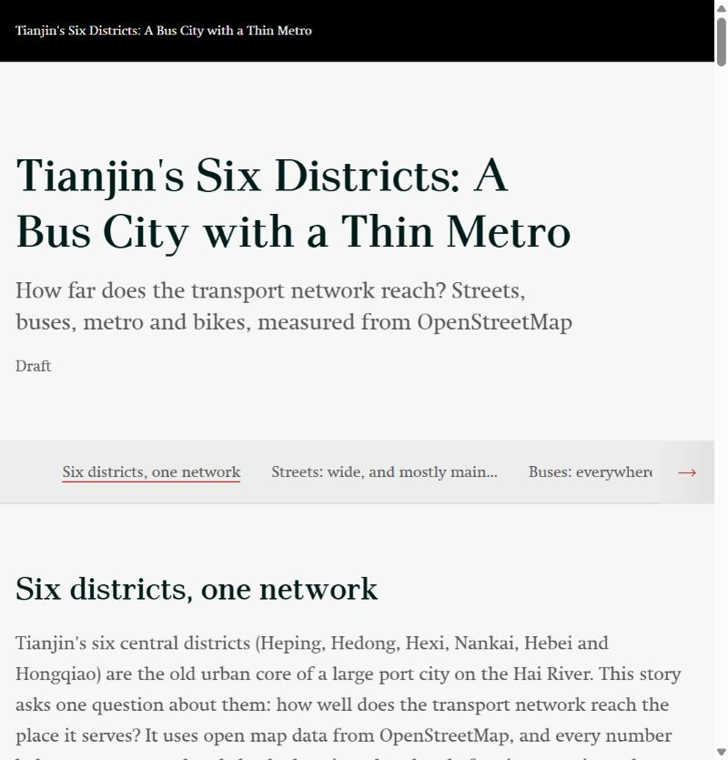
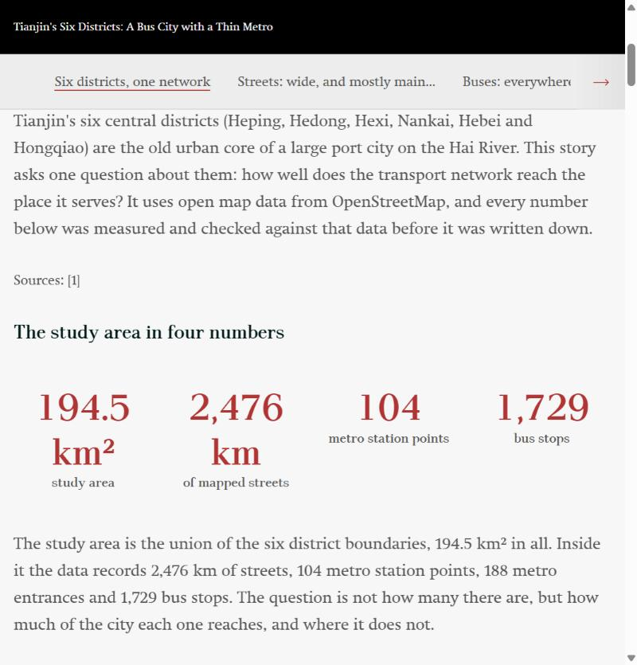
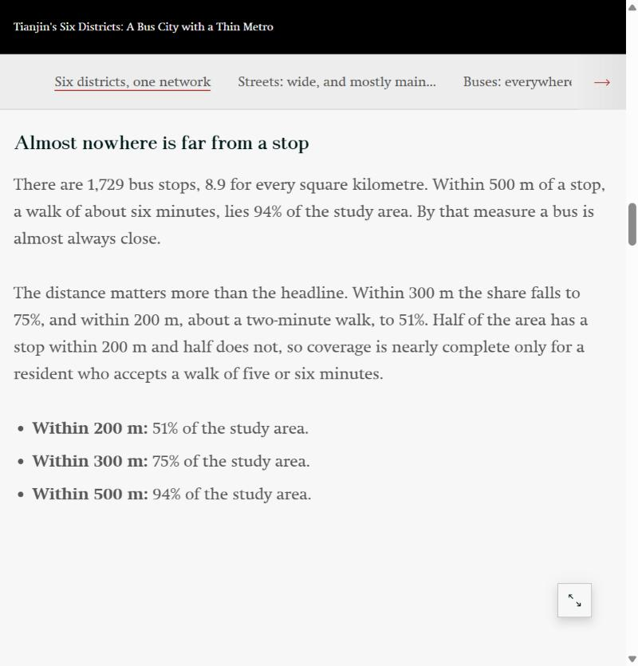
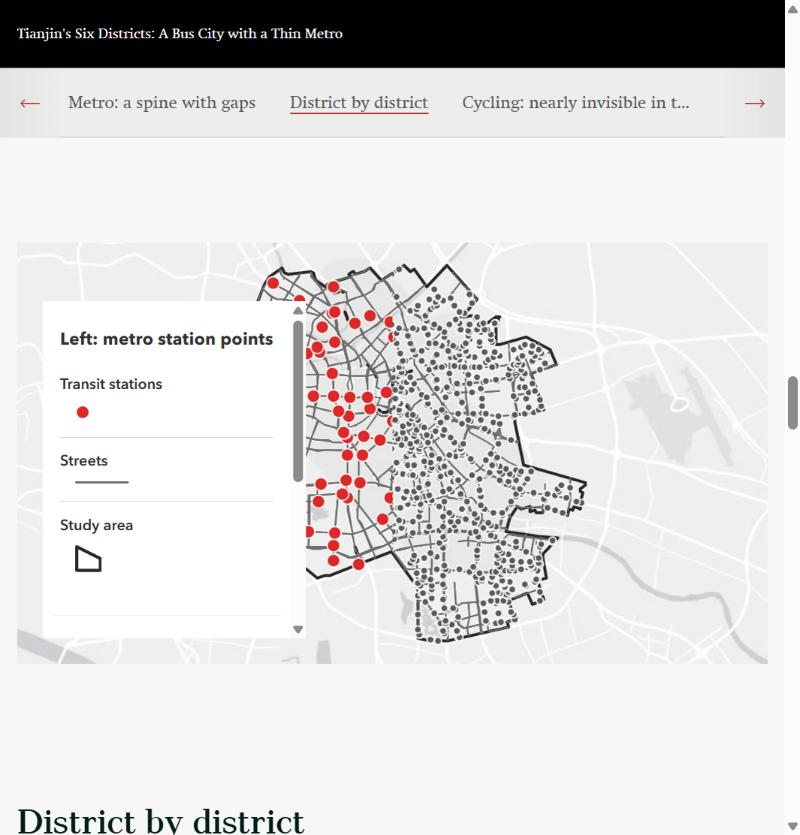
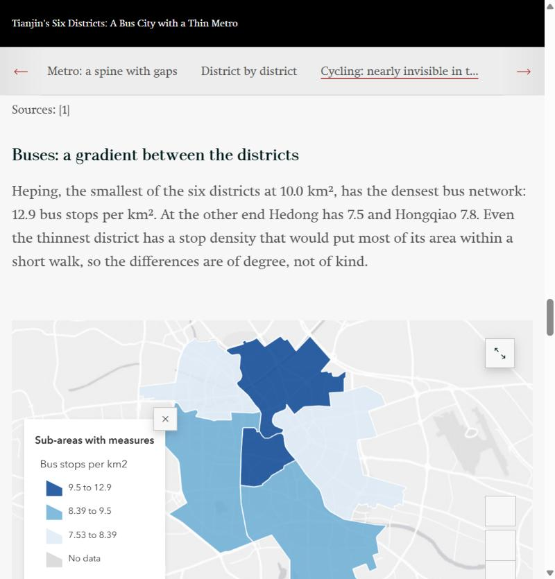
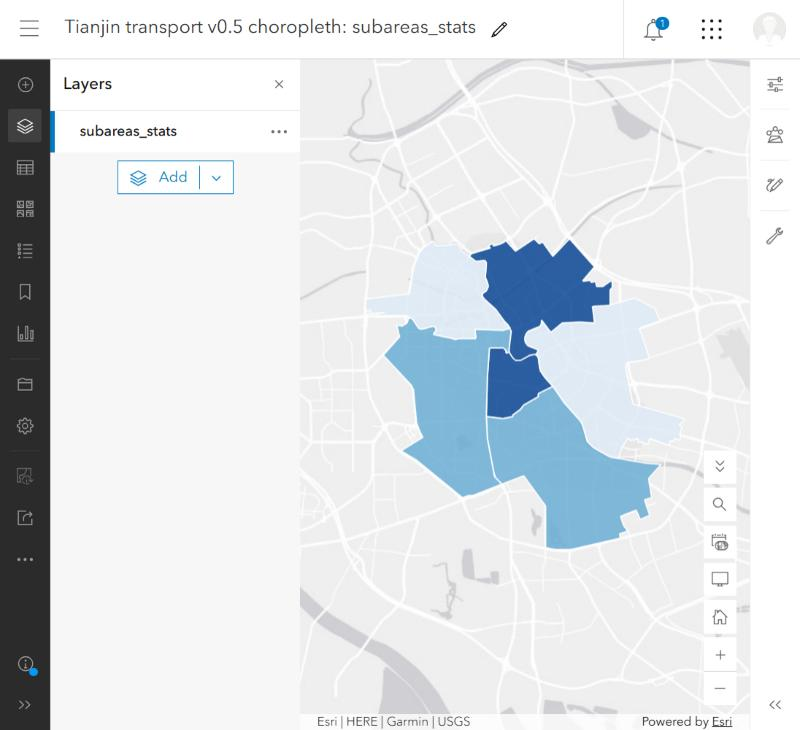

# Showcase: Tianjin's six central districts, a transport story

The second place the tool was run on, chosen to be unlike the first: a Chinese city (place names and data in Chinese), six districts treated as one study area (194.5 km², about 47 times the size of the Gràcia example), and a transport theme.
The data is in `fixtures/tianjin/`, so the checks run offline:

```bash
storymap-gen run examples/tianjin_transport.json --manifest fixtures/tianjin/manifest.json
storymap-gen findings --manifest fixtures/tianjin/manifest.json
```

## From a place to a thesis
```bash
storymap-gen region "Heping District, Tianjin, China" "Hedong District, Tianjin, China" "Hexi District, Tianjin, China" \
  "Nankai District, Tianjin, China" "Hebei District, Tianjin, China" "Hongqiao District, Tianjin, China" --name "Tianjin central six districts"
storymap-gen fetch --region region.json --layers streets transit bus_stops bike schools health water --out data/
storymap-gen findings --manifest data/manifest.json --claims-out findings.json
```
Two things went wrong on the way and are now handled by the tool: the Nominatim match for Hedong District carried a stray piece of boundary hundreds of kilometres away (in another province), which would have turned the study area into
90,000 km²; the tool now drops parts that are far from the main body and says so. And a single place name returns one match, so several places can now be given and are combined into one study area.

The data explorer (`storymap-gen explore`) shows what was downloaded, with the real counts, before any writing starts:



`findings` ran in 12 seconds and ranked what the data shows. The top of its list became the story's argument: a bus network that is nearly complete at 500 m (94% of the area) but covers only half the area at 200 m;
a metro that reaches 48% of the area within 500 m; and a mapped cycling network so thin (2% of the area within 100 m of a route) that the honest finding is about the map as much as the city.

## What came out
Eight sections, 16 subsections, seven maps (one a swipe, two coloured by district), a row of key figures, lists, and 53 claims, all passing. The gate also reported no depth warnings.
Opened in the real Builder, with 8,904 street segments, 1,729 bus stops and 306 metro points in the maps:



*Bus stops over the main roads: the map the 94% / 75% / 51% numbers describe.*



*The swipe: the metro (left) is a spine through the centre and west; the buses (right) fill the rest.*

## Pages from the story
Screenshots of the draft in the StoryMaps preview, text and maps together:











## Comparing the six districts
The study area is six districts, so a story that treats it as one lump hides the point. `subareas` and `aggregate` give each district its own bus-stop and metro-point density, and a graduated-colour map shows them:



*Bus-stop density by district (three classes, quantile breaks). Heping, the smallest district, is darkest at 12.9 stops per km2; Hedong, the lightest, has 7.5. The figures in the story are claims on the derived layer, so a sentence cannot drift from the map.*

## What this does and does not show
- The statistics in the story were measured by the tool, and the story's structure came from the same pipeline as the first example; no code was written for Tianjin.
- The **writing** of this story was still done by a model (this one) working from the `findings` output. The tool measures and checks; it does not write. Whether a fresh model, given only the skill, reaches the same quality is tested separately, see [the validation log](../validation-log.md).
- The data is OpenStreetMap, which maps cycling lanes and small clinics incompletely in this city; the story says so and treats those numbers as a floor.
