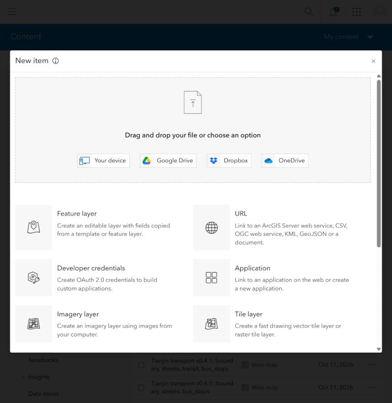
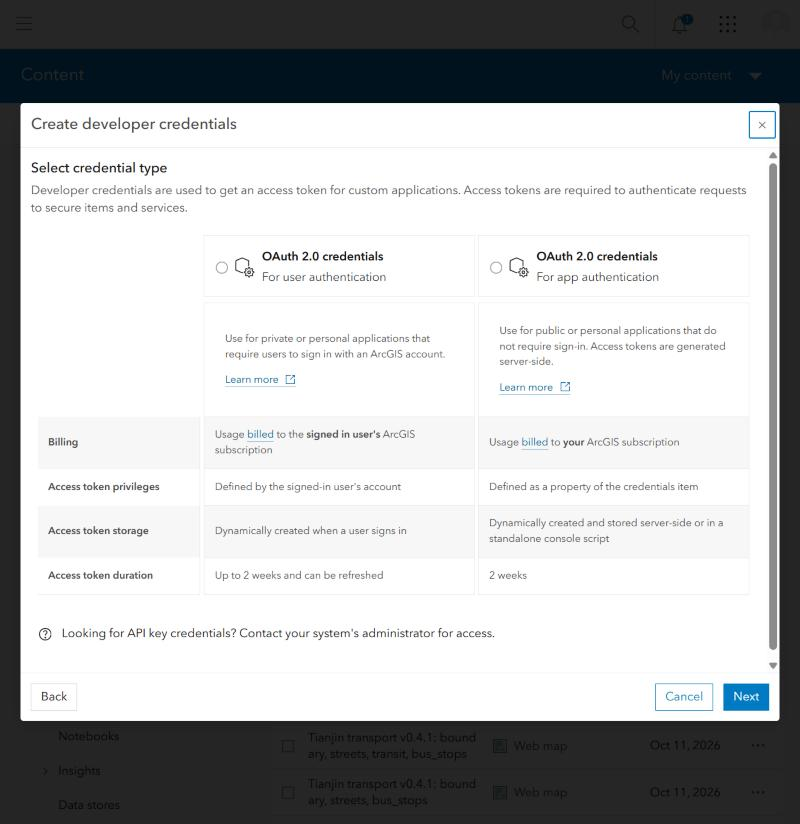
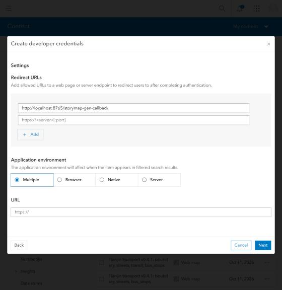
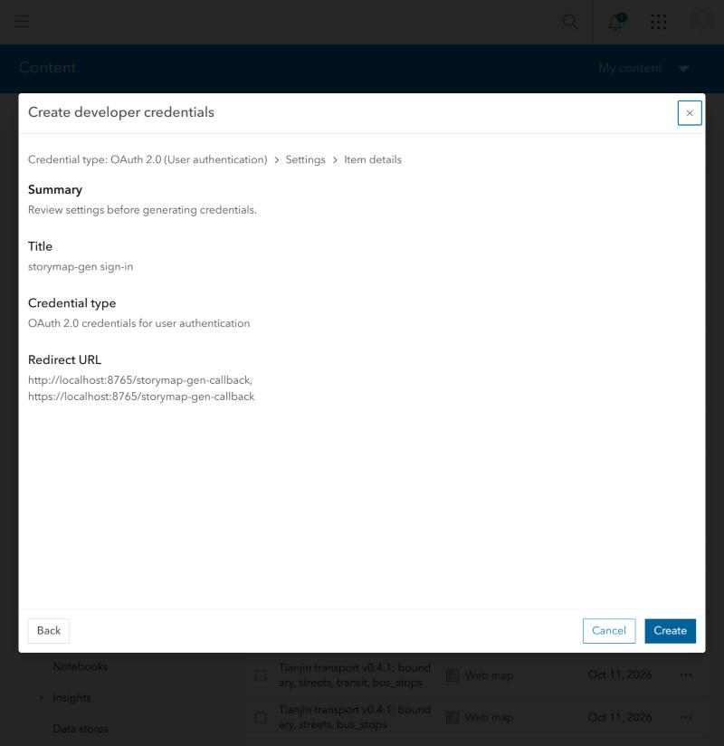

# Step by step: from nothing to a private draft in ArcGIS

Follow the steps in order. Each ends with a **checkpoint**: what you should see before going on. If a checkpoint does not match, stop and look at [When something goes wrong](getting-started.md#when-something-goes-wrong).
Steps 1 to 4 need no ArcGIS account and take about ten minutes. Steps 5 and 6 (about five minutes, once) are only needed to put a story in ArcGIS.

| step | what | time | needs |
|---|---|---|---|
| 1 | Install Python | 5 min, once | internet |
| 2 | Get the project | 2 min, once | internet |
| 3 | Try it on sample data | 2 min | nothing |
| 4 | Add it to Claude Code (optional, the easy way) | 1 min, once | Claude Code |
| 5 | One-time ArcGIS setup | 3 min, once | ArcGIS Online account with a publisher role |
| 6 | Sign in | 1 min each time | a browser |
| 7 | Make a story | 15 to 40 min | internet |
| 8 | Publish a private draft and finish it in ArcGIS | 5 min | signed in |

## Step 1. Install Python (version 3.10 or newer)
- **Windows:** download the installer from <https://www.python.org/downloads/>, run it, and **tick "Add python.exe to PATH"** on the first screen.
- **macOS:** install from the same page, or with `brew install python`.
- **Check:** open a terminal (Windows: PowerShell; macOS: Terminal) and run `python --version` (on macOS maybe `python3 --version`). **Checkpoint:** it prints `Python 3.10` or higher. If Windows says "python is not recognised", reinstall and tick the PATH box.

## Step 2. Get the project
Either with git:
```bash
git clone https://github.com/hazelxue/storymap-gen
cd storymap-gen
```
or without git: on the project's GitHub page choose **Code, Download ZIP**, unzip it, and open a terminal inside the unzipped folder (Windows: in File Explorer open the folder, then right-click an empty space and choose **Open in Terminal**).
Then install it:
```bash
python -m pip install -e ".[mcp]"
```
**Checkpoint:** `python -m storymap_gen --version` prints `storymap-gen 0.5.0`. (On Windows PowerShell, run one command per line; it has no `&&`.)

## Step 3. Try it on sample data (no account)
```bash
python -m storymap_gen run examples/gracia_barcelona_full.json --manifest fixtures/gracia/manifest.json
python -m storymap_gen explore --manifest fixtures/gracia/manifest.json --open
```
**Checkpoint:** the first command ends with `Quality gate passed`; the second opens a map of the data in your browser (toggle layers on the left, click a feature to see its attributes).
What happened: 46 sentences' worth of numbers about a Barcelona district were measured on real data and all matched.

## Step 4. Add it to Claude Code (the easy way)
Claude Code is Anthropic's coding assistant; install it from <https://claude.com/claude-code>. Then, in the project folder:
```bash
python scripts/install_skill.py
```
**Checkpoint:** it prints `Installed the storymap-gen skill into ...`. Start Claude Code in any empty folder and ask, in plain language: *"Make a StoryMap about transport in Hexi District, Tianjin."* It will ask you the questions in step 7.
No Claude Code? Skip this step; every action is also a command (step 7, "the commands").

## Step 5. One-time ArcGIS setup (so the tool may sign in as you)
You need an ArcGIS Online account that can create content (a publisher role; if the buttons below are missing, ask your organisation's administrator). You create one small item, an "OAuth credential": it is what ArcGIS asks you to approve when the tool signs you in. **It holds no password.**

1. Sign in to ArcGIS Online in your browser, open **Content**, click **New item**, and choose **Developer credentials**.

   

2. Choose **OAuth 2.0 credentials, For user authentication**, then **Next**.

   

3. In **Redirect URLs** type exactly `http://localhost:8765/storymap-gen-callback`. Leave the rest as it is and click **Next**. (You can also click **Add** and enter `https://localhost:8765/storymap-gen-callback`; it is only used by the fallback sign-in for computers with no browser.)

   

4. Give it a title such as `storymap-gen sign-in`, click **Next**, check the summary, and click **Create**.

   

5. On the new item's page, scroll to **Credentials** and click the **copy** icon next to **Client ID** (use the button: some letters look alike). Paste it somewhere you can find it for step 6. The page also shows a **Client Secret** and a **temporary token**: you need neither, and you should never share them.

**Checkpoint:** you have the Client ID copied, and the item `storymap-gen sign-in` appears in your Content. **Do not delete that item**: sign-in stops working if you do.

## Step 6. Sign in
In the project folder, the first time:
```bash
python -m storymap_gen login --client-id <paste the Client ID> --portal <your-organisation>.maps.arcgis.com --stay-signed-in
```
`<your-organisation>.maps.arcgis.com` is the address you use to open ArcGIS Online (for example `myorg.maps.arcgis.com`). Your browser opens on ArcGIS's own page: sign in if asked and click **Allow**. The page then says **Signed in** and you can close it. **Nothing to copy or paste.**
**Checkpoint:** the terminal prints `Signed in as <your username>`. Next times it is just `python -m storymap_gen login --stay-signed-in` (the Client ID and organisation are remembered). `--stay-signed-in` renews the sign-in for about two weeks; without it, you sign in again after half an hour. `python -m storymap_gen status` shows whether you are signed in.
If ArcGIS says the **redirect URL is not valid**, step 5.3 was typed differently; fix it in the item's settings. If nothing happens for three minutes the command stops waiting; run it again and click Allow.

## Step 7. Make a story
**With Claude Code (step 4):** ask for the story. Claude walks you through five things, in this order, and checks every number before it writes it down:
1. **Sign in** (step 6), if you want a draft in ArcGIS at the end.
2. **The study area**: a place name, or several places that together make it (a district, a neighbourhood; up to 150 km² per download).
3. **The data**: it tells you what it will download (OpenStreetMap, free and public) and asks first; or you give it your own files. You see what the data holds, a map of it, and what is notable in it.
4. **Your outline and question**: paste an outline, or choose a structure; say the audience and the length.
5. **The story**: it writes, the tool checks every number against the data and stops until they are right, and you review.

**With the commands** (no Claude Code):
```bash
python -m storymap_gen region "Gràcia, Barcelona" --out region.json
python -m storymap_gen fetch --region region.json --layers streets parks transit bus_stops schools --out data/
python -m storymap_gen explore --manifest data/manifest.json --open
python -m storymap_gen findings --manifest data/manifest.json --claims-out findings.json
python -m storymap_gen init --region region.json --topic "Green space in Gràcia" --manifest data/manifest.json --out spec.json
```
then edit `spec.json` (replace every `TODO`, and back every number with a claim; see [the writing guide](writing-guide.md)) and run
```bash
python -m storymap_gen run spec.json --manifest data/manifest.json --out story.json
```
**Checkpoint:** `Quality gate passed`. A `FAIL`, `UNBACKED` or `PLACEHOLDER` line means the gate stopped the story and says what to fix. `THIN` lines are advice, not errors.
**What makes the story better, and only you can add:** your own photographs, a table of numbers (income, population: `python -m storymap_gen join ...`, see [thematic maps](thematic-maps.md)), and what you know about the place.

## Step 8. Publish a private draft and finish it in ArcGIS
```bash
python -m storymap_gen publish-spec spec.json --manifest data/manifest.json --title "My story" --download-images
```
(`--download-images` only if the story has pictures.) **Checkpoint:** it prints `Created private draft: https://storymaps.arcgis.com/stories/.../edit`. Open that link, read the story as a reader would, fix what needs fixing in the StoryMaps Builder, then **publish and share it yourself**. Everything the tool created is private until you share it; it never publishes for you, never overwrites an existing story, and never deletes anything.

## When you are done
- `python -m storymap_gen logout` removes the saved sign-in and revokes the renewal at ArcGIS.
- Test items you no longer want (drafts, maps) are deleted in ArcGIS yourself. Keep the `storymap-gen sign-in` item if you will use the tool again.
- **Never paste a token, a Client Secret or the address you land on after signing in into a chat window or an issue.** Before you share a screenshot, check that it shows no organisation name, user name or Client ID.

Something unclear or broken? [Tell us how it went](https://github.com/hazelxue/storymap-gen/issues/new/choose): a short form, no code needed.
